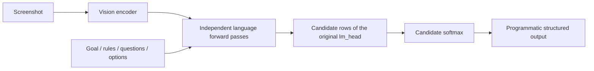

# GUI Verifier

**English** | [简体中文](README.zh-CN.md)

**Screenshots in, decisions out. A small GUI verifier built on Qwen3.5-0.8B.**

Jev got me thinking about a familiar pattern: we ask a model to make a simple decision, then wait while it writes the answer token by token. I wanted to try that direct-decision idea on screenshots.

GUI Verifier takes an image and questions like “Is the success message visible?” or “Is the toggle on?” It reads candidate scores and returns `yes / no / unknown` through code. Multiple questions can reuse the same image's vision features.

## What I took away from the experiment

**The Jev-inspired direction is worth pursuing for screenshot checks: when the answer is a choice, skipping answer generation can get that choice back sooner.**

I trained two versions of the same Qwen3.5-0.8B base: decision LoRA and JSON-output SFT. Their judgment quality was close on this development set—90.18% versus 89.80% accuracy, with constrained JSON at 91.25%—while latency showed a clearer benefit:

| Questions per screenshot | Direct decisions p50 | JSON SFT generation p50 | Latency ratio |
|---|---:|---:|---:|
| 1 | **58.93 ms** | 137.31 ms | 2.33× |
| 2 | **70.23 ms** | 177.45 ms | 2.53× |
| 4 | **185.81 ms** | 243.13 ms | 1.31× |

This compares two trained systems on the same hardware, using 100 screenshots per question count and five repetitions per method. It is not a benchmark of Jev. Labels are teacher-generated development labels; the [experiment details](#experiment-details) below include the full metrics and statistical limits.

What interests me here is another useful job for a small vision-language model: repeated state checks, with less time spent waiting for an answer to be generated.

## Where I want to use it

**Checking an agent's last action.** After clicking Save, look for the success message. After changing a setting, check the toggle. A parent workflow could use the result to continue, wait, or retry.

**UI regression checks.** Questions such as “Is the submit button visible?” or “Has an error message appeared?” could supplement existing tests after a UI change. Each application would need its own evaluation.

**State-dependent automation.** A login screen, loading state, error page, and completion screen call for different next steps. Returning `unknown` when the image is inconclusive gives the workflow a chance to ask for review.

These are integration directions, not measured end-to-end improvements. This experiment evaluates screenshot judgments; it has not measured full-agent success or total runtime. A screenshot also cannot prove a hidden backend transaction completed.

Inference, training, evaluation, and [extended annotations with fixed splits](datasets/gui-verifier-v1/) are in this repository. Images come from upstream; trained adapters are not yet released. This is an independent implementation, not a reconstruction of Jev's internal architecture or training.

## How it works



- Score candidate letters at the final input position, then map them to option IDs. The decision path does not call `generate` or append answer tokens.
- Keep the original `lm_head`; there is no added scalar head, RLCD, pairwise ranking loss, or permutation-KL objective.
- The fast backend merges LoRA, shares vision features within one request, and restricts the output projection to candidate rows. Questions still require independent language computation: **no shared language-prefix KV cache**.
- BF16 standard and fast paths are not bit-identical. Decision LoRA accuracy is 90.41% with standard logits and 90.18% with fast logits.
- Training uses `yes` / `no` / `unknown`. The API supports custom candidates, but arbitrary candidate tasks have not been validated by this experiment.

## Environment

Tested: Linux, Python 3.12.3, PyTorch 2.12.1+cu130, Transformers 5.17.0, PEFT 0.21.0. See [environment.json](reports/published/environment.json). The fast backend uses model internals; revalidate it after a Transformers upgrade.

The GPU reported **RTX 4090 with 49,140 MiB**, not a standard 24GB configuration. Peak PyTorch allocated memory was approximately 2.57 GiB for decision training and 2.09 GiB for JSON SFT. These are **not minimum VRAM requirements**: driver/context/reserved memory and larger images or batches add overhead. CPU/MPS training performance was not tested.

```bash
python -m venv .venv
source .venv/bin/activate
# First install torch and torchvision for your CUDA/driver combination.
pip install -e '.[train,test]'
pip install -r requirements-experiment004.txt
pytest -q
```

`causal-conv1d` may require a matching CUDA toolkit and `nvcc` to build. Reference kernels without the acceleration packages cannot be assumed to match these latency results. The package's broad dependency ranges are not a compatibility guarantee for every combination.

Only the training entry points need `torch` and `peft`, and both are imported inside `main()`. On a machine without a CUDA stack, `pip install -e '.[test]'` is enough for `pytest -q` to collect and run the non-training tests. Training itself still requires a BF16-capable CUDA GPU.

## Quick start

Download the pinned base model, then create synthetic demo screenshots:

```bash
python -c "from huggingface_hub import snapshot_download; snapshot_download('Qwen/Qwen3.5-0.8B', revision='2fc06364715b967f1860aea9cf38778875588b17', local_dir='models/Qwen3.5-0.8B')"
python tools/prepare_data.py

gui-verify --model models/Qwen3.5-0.8B \
  --image data/synthetic/images/test-0000.png \
  --request examples/request.json \
  --fast --batch-size 4 --max-pixels 786432 \
  --output outputs/example.json
```

This uses **base weights**, not the adapter that achieved 90.18%. After training your own adapter, add `--adapter outputs/decision-lr5e5-seed404/best-adapter`. Demo images are programmatically rendered, not the real screenshots used in Experiment 004.

### Local web UI and API

```bash
GUI_MODEL=models/Qwen3.5-0.8B GUI_BACKEND=fast GUI_BATCH_SIZE=4 GUI_MAX_PIXELS=786432 \
  uvicorn gui_verifier.api:app --host 127.0.0.1 --port 8765
curl http://127.0.0.1:8765/v1/verify -F image=@screenshot.png -F 'request=<examples/request.json'
```

Open http://127.0.0.1:8765 . Set `GUI_ADAPTER` to load an adapter. In Windows PowerShell use `.venv\Scripts\Activate.ps1` and `$env:GUI_MODEL='models/Qwen3.5-0.8B'` for environment variables. This research server has no authentication; keep it local.

### Request and response

Send a PNG/JPEG/WebP image separately from this request:

```json
{
  "goal": "Check whether saving is visibly complete",
  "rules": ["Use only visible evidence; do not infer server state."],
  "questions": [{
    "id": "saved",
    "text": "Is a save-success notification visible?",
    "options": [
      {"id": "yes", "text": "Yes"},
      {"id": "no", "text": "No"},
      {"id": "unknown", "text": "Cannot determine from the screenshot"}
    ],
    "unknown_option_id": "unknown"
  }]
}
```

CLI/API responses contain `model`, `decisions`, `timing_ms`, and `metadata`. Each decision contains `question_id`, `selected_option_id`, `probabilities`, `candidate_logits`, `status`, and `margin`; see [schema.py](src/gui_verifier/schema.py).

`unknown` is a semantic class; `review` is a policy flag for low scores, small margins, or option-order inconsistency, preserving the original prediction. Candidate softmax is not automatically a correctness probability. Default review thresholds are not validated production acceptance thresholds.

The verifier does not click, type, or operate a browser. Screenshot text is treated as untrusted, but prompt-injection robustness has not been systematically tested. A screenshot cannot prove that a hidden backend transaction succeeded.

## Data and training

| Split | Screenshots | Judgments | Groups |
|---|---:|---:|---:|
| Train | 2,251 | 10,266 | 2,155 |
| Validation | 288 | 1,314 | 269 |
| Calibration | 280 | 1,286 | 270 |

The dataset is extended from [OS-Atlas](https://huggingface.co/datasets/OS-Copilot/OS-Atlas-data) and [ScreenQA](https://github.com/google-research-datasets/screen_qa). Download the [annotations, source manifest and splits](datasets/gui-verifier-v1/); see its README to reconstruct images acquired from upstream. Detected overlaps with reserved ScreenSpot images were removed. Group IDs are disjoint across splits, but this does not rule out all semantic/template leakage. Contrastive examples currently change a fact in the **question about the same image**; they are not pairs of screenshots with one visual fact changed.

A JSONL record contains `id`, `group_id`, `image` (relative to the JSONL), `request`, and `labels` mapping question IDs to option IDs. Labels never enter the prompt. Related screenshots and counterfactual variants should share a group ID before splitting. See [the full contract and recipe](docs/TRAINING.md) (Chinese).

Both recipes freeze vision and base weights and train language-side LoRA: rank 16, alpha 32, dropout 0.05, BF16, AdamW, weight decay 0.01, gradient clipping 1, 5% warmup, linear decay, three epochs. Search learning rates `2e-5` and `5e-5`, seed404 only.

- **Decision LoRA:** candidate-only cross-entropy, randomized option order; micro-batch 4, effective batch 8, 1,284 updates/epoch.
- **JSON SFT:** up to four questions per sequence, assistant JSON + EOS loss only, aligned question/answer shuffling; effective batch 8 sequences, 485 updates/epoch.
- Supervised judgment exposure per epoch is matched; sequence counts, steps, and compute budgets are not.

```bash
python tools/train004.py --model models/Qwen3.5-0.8B \
  --train datasets/gui-verifier-v1/final/train.jsonl --validation datasets/gui-verifier-v1/final/validation.jsonl \
  --output outputs/decision-lr5e5-seed404 --mode decision --lr 5e-5 --seed 404 --epochs 3

python tools/train004.py --model models/Qwen3.5-0.8B \
  --train datasets/gui-verifier-v1/final/train.jsonl --validation datasets/gui-verifier-v1/final/validation.jsonl \
  --output outputs/json-lr5e5-seed404 --mode json --lr 5e-5 --seed 404 --epochs 3
```

Repeat with `--lr 2e-5` and distinct output directories. Validation runs roughly every half epoch; selection favors macro-F1, then lower false-success rate within a 0.002 F1 tie. Selected checkpoints: decision `5e-5`, step 1926; JSON `5e-5`, step 1455. Interrupted training directories are not overwritten or automatically resumed.

## Evaluation and calibration

```bash
python tools/evaluate004.py --model models/Qwen3.5-0.8B \
  --adapter outputs/decision-lr5e5-seed404/best-adapter \
  --data datasets/gui-verifier-v1/final/validation.jsonl \
  --output outputs/experiment-004/decision-selected-full --speed-screens 100 --repeats 5
```

Omit `--adapter` and use output `base-full` for the base model; use the JSON adapter and output `json-selected-full` for the JSON SFT model. All methods run by default: `json,json_constrained,logits,fast`.

```bash
python tools/evaluate004.py --model models/Qwen3.5-0.8B \
  --adapter outputs/decision-lr5e5-seed404/best-adapter \
  --data datasets/gui-verifier-v1/final/calibration.jsonl \
  --output outputs/experiment-004/calibration-eval --methods fast --speed-screens 0
python tools/analyze004.py --root outputs/experiment-004
```

Ordinary and constrained generation share prompts, greedy decoding, disabled thinking, and explicit EOS. Constrained generation adds a legal-array token prefix tree; it still generates autoregressively. JSON sees all questions and previous answers, whereas logits questions are independent: multi-question context is not identical.

Timing uses `max_pixels=786432`, warmup, merged adapters, CUDA synchronization, and concurrency one. It includes processing decoded RGB, tokenization, transfers, computation, and output handling; it excludes model loading and disk image decoding. No cross-request image/answer cache. Full quality evaluation uses all natural questions; speed uses K-question subsets. Format validity can therefore differ between those reports. K=8 lacked enough distinct questions and was not measured.

Calibration-only fitting selected temperature **2.14355**. Validation ECE(10 bins) fell from 0.06665 to 0.02935 and NLL from 0.31690 to 0.23604. Temperature does not change argmax. This is offline analysis, **not enabled by default in the CLI/API**, and does not establish a safe auto-accept threshold.

Missing evaluations include independent human gold, cross-application holdout, multiple seeds, visual-fact counterfactuals, adversarial/blur robustness, concurrency, and full agent success. Do not interpret the results as production readiness or superiority over Jev.

## Repository and release scope

```text
src/gui_verifier/       Inference, API, CLI, schemas, web UI
examples/              Request examples
tools/train004.py      Decision LoRA / JSON SFT
tools/evaluate004.py   Quality, format, and latency evaluation
tools/analyze004.py    Group bootstrap and temperature calibration
docs/                  Detailed recipes, results, licenses (Chinese)
reports/published/     Aggregate reports, without business input text
requirements-experiment004.txt
```

The release includes expanded annotations, fixed splits and image provenance. It excludes credentials, internal infrastructure tools, original screenshots, raw teacher outputs and weights/adapters. Images must be acquired under upstream terms and reconstructed using `tools/restore_dataset_images.py`. Adapters are not public; exact results still require training and matching the recorded environment. See [release notes](docs/RELEASE.md).

## Experiment details


Experiment 004, completed September 23, 2026. **288 screenshots, 1,314 judgments**, with teacher-generated labels reviewed by the same teacher model. This is a **silver development validation set**, also used for checkpoint and learning-rate selection—not an independent human-labeled test set.

| Model / inference | Strict accuracy | Macro-F1 | Valid output format | False-success rate ↓ |
|---|---:|---:|---:|---:|
| Base Qwen · fast logits | 48.93% | 33.30% | 100% (programmatic) | 67.57% |
| Decision LoRA · fast logits | **90.18%** | 91.88% | 100% (programmatic) | **5.56%** |
| JSON SFT · generation | 89.80% | 92.17% | 97.92% | 6.59% |
| JSON SFT · constrained generation | **91.25%** | **92.67%** | 100% | 7.24% |

Malformed arrays count as failures for every question in that request. False-success rate is the fraction of gold `no`/`unknown` judgments predicted as `yes`. Invalid outputs are accuracy failures but do not count as predicted `yes`; read this metric together with format validity.

| Questions per screenshot | Decision LoRA fast logits p50 | JSON SFT generation p50 | System p50 ratio |
|---|---:|---:|---:|
| 1 | 58.93 ms | 137.31 ms | 2.33× |
| 2 | 70.23 ms | 177.45 ms | 2.53× |
| 4 | 185.81 ms | 243.13 ms | 1.31× |

Each K uses 100 screenshots and five repetitions per method. These compare **differently trained systems**, not a single isolated inference optimization. At K=4, fast logits does not beat same-weight constrained JSON on p95 latency.

The accuracy difference between decision fast logits and JSON SFT generation is +0.38 percentage points. A 2,000-replicate bootstrap over 269 groups gives a conditional 95% interval of **[-2.10, +3.05] points**: no demonstrated accuracy advantage. Constrained JSON SFT achieves the highest observed accuracy.

Machine-readable [results](reports/published/) include every model/protocol combination; the [detailed report](docs/RESULTS_004.md) is in Chinese. Reported gains are development-set findings, not production or Jev benchmark claims.

## License and acknowledgments

Code: [MIT](LICENSE). Models, datasets, and dependencies retain their own terms. Qwen3.5-0.8B and the OS-Atlas dataset card state Apache-2.0; ScreenQA states CC BY 4.0. Screenshot contents may require additional review; see [third-party references](docs/THIRD_PARTY.md).

Thanks to Qwen, OS-Atlas, ScreenQA, ScreenSpot, Transformers, PEFT, and FLA. Jev-style interfaces and community approaches including SemIf and Nimble inspired the experiment design; this project does not claim to reproduce their complete methods.

Working on GUI agents, interface regression, or screenshot verification? Contributions, reproducible failure cases, and evaluation suggestions are welcome. If this direction is useful to you, consider starring the project.
