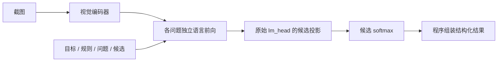

# GUI Verifier

[English](README.md) | **简体中文**

**截图进来，判断出去。基于 Qwen3.5-0.8B 的轻量 GUI 验证器。**

做这个项目，是受 Jev 启发：很多时候，我们只需要模型做一个判断，却还在等它把答案一个 token 一个 token 地写出来。我想把这种直接决策的思路放到视觉任务上试一试。

于是有了 GUI Verifier。给它一张截图，问“保存成功的提示出现了吗？”“开关打开了吗？”，它直接读取候选分数，由程序返回 `yes / no / unknown`。多道问题可以复用同一张图的视觉特征。

## 这次实验让我看到了什么

**Jev 启发的这条路，在截图判断上值得继续做：任务只需要选择时，省去答案生成，确实可以更快得到结果。**

我用同一个 Qwen3.5-0.8B 底座，分别训练了决策 LoRA 和输出 JSON 的 SFT 模型。在本次开发验证中，两条路线的判断效果接近（90.18% 对 89.80%，约束 JSON 为 91.25%），更明显的收益来自响应速度：

| 一张图问几题 | 直接判断 p50 | JSON SFT 普通生成 p50 | 延迟比 |
|---|---:|---:|---:|
| 1 题 | **58.93 ms** | 137.31 ms | 2.33× |
| 2 题 | **70.23 ms** | 177.45 ms | 2.53× |
| 4 题 | **185.81 ms** | 243.13 ms | 1.31× |

这是两个训练后系统在同一硬件上的比较，每个题数取 100 张图、每种方法重复 5 次；不是对 Jev 本身的测速。标签是教师生成的开发验证标签，完整指标和统计边界见下方[实验明细](#实验明细)。

对我来说，这个结果最有意思的地方，是给视觉模型多了一种用法：在需要频繁检查状态的地方，让一个小模型专门做判断，把等待答案生成的时间省下来。

## 我想把它用在哪里

**GUI Agent 的操作后检查。** 点完“保存”，再看一眼是否出现了成功提示；切换设置后，检查开关状态。验证结果可以交给上层流程决定继续、等待或重试。

**界面回归测试。** 页面改版后，用“提交按钮是否可见”“错误提示是否出现”这样的自然语言问题补充检查。它可以作为现有测试的补充，具体场景还需要单独验证。

**自动化流程中的状态分支。** 登录页、加载中、报错页、完成页，往往决定流程接下来该做什么。无法从画面确认时返回 `unknown`，让流程有机会停下来复核。

这些都是我希望继续验证的接入方向。本轮测的是截图判断，还没有测完整 Agent 的成功率或总耗时；截图也不能证明后台事务真的完成了。

代码、训练和评估脚本、[扩展标注与数据划分](datasets/gui-verifier-v1/)都在仓库里。图片从上游取得，微调适配器暂未发布。这个项目是独立实现，不代表 Jev 的内部架构或训练方法。

## 原理



- 不调用 generate，不生成答案 token；最后输入位置对 A/B/C 等候选字母打分，再映射回标签。
- 保留原始 lm_head，没有新增 scalar head，也没有实现 RLCD、成对排序损失或换序 KL。
- `fast` 路径在单个请求内复用视觉特征，合并 LoRA，仅计算候选投影；问题仍各自进行语言计算，**不共享语言前缀 KV**。
- 标准与快速路径在 BF16 下不是逐位一致，边界预测可能变化：本次决策权重普通 logits 准确率 90.41%，快速路径 90.18%。
- 训练标签为 yes/no/unknown。API 支持自定义候选，但本次结果不能外推到任意候选任务。

## 环境与安装

实验环境：Linux、Python 3.12.3、PyTorch 2.12.1+cu130、Transformers 5.17.0、PEFT 0.21.0。完整版本见 [环境摘要](reports/published/environment.json)。快速路径依赖模型内部接口，升级 Transformers 后必须重验。

设备报告为 RTX 4090、49140 MiB 显存，**不是标准 24GB 4090 配置**。本次决策训练峰值 allocated 约 2.57 GiB，JSON SFT 约 2.09 GiB；这不是显卡最低容量要求，不含所有驱动、上下文及 reserved 开销，长图和更大 batch 会增加用量。未验证 CPU/MPS 训练性能。

```bash
python -m venv .venv
source .venv/bin/activate
# 先安装与本机 CUDA/驱动匹配的 torch、torchvision。
pip install -e '.[train,test]'
pip install -r requirements-experiment004.txt
pytest -q
```

causal-conv1d 可能需要本机 CUDA toolkit/nvcc 编译；安装时应匹配 PyTorch CUDA。缺少加速内核的参考实现可能可运行，但不能引用本次延迟作为其性能。Python 包声明的宽版本范围不代表每个版本组合都经过验证。

只有训练入口需要 `torch` 和 `peft`，两者都在 `main()` 内导入。没有 CUDA 环境的机器装 `pip install -e '.[test]'` 之后，`pytest -q` 就能收集并跑通非训练测试；训练本身仍然要求支持 BF16 的 CUDA GPU。

## 快速开始

下载固定版本基础模型（仅下载模型，不下载数据）：

```bash
python -c "from huggingface_hub import snapshot_download; snapshot_download('Qwen/Qwen3.5-0.8B', revision='2fc06364715b967f1860aea9cf38778875588b17', local_dir='models/Qwen3.5-0.8B')"
python tools/prepare_data.py

gui-verify --model models/Qwen3.5-0.8B \
  --image data/synthetic/images/test-0000.png \
  --request examples/request.json \
  --fast --batch-size 4 --max-pixels 786432 \
  --output outputs/example.json
```

这条命令使用**基础权重**，不具有微调后的 90.18% 成绩。自行训练后添加 `--adapter outputs/decision-lr5e5-seed404/best-adapter`。示例界面为程序绘制的合成数据，不是实验 004 的真实截图。

本地网页和 API：

```bash
GUI_MODEL=models/Qwen3.5-0.8B GUI_BACKEND=fast GUI_BATCH_SIZE=4 GUI_MAX_PIXELS=786432 \
  uvicorn gui_verifier.api:app --host 127.0.0.1 --port 8765
curl http://127.0.0.1:8765/v1/verify -F image=@screenshot.png -F 'request=<examples/request.json'
```

打开 http://127.0.0.1:8765 。微调模型通过环境变量 `GUI_ADAPTER` 指定。Windows PowerShell 使用 `.venv\Scripts\Activate.ps1` 与 `$env:GUI_MODEL='models/Qwen3.5-0.8B'` 等方式设置变量。服务无鉴权，默认只监听本地，不要直接暴露公网。

## 输入输出

PNG/JPEG/WebP 截图通过独立 image 字段传入。请求格式：

```json
{
  "goal": "Check whether saving is visibly complete",
  "rules": ["Use only visible evidence; do not infer server state."],
  "questions": [{
    "id": "saved",
    "text": "Is a save-success notification visible?",
    "options": [
      {"id": "yes", "text": "Yes"},
      {"id": "no", "text": "No"},
      {"id": "unknown", "text": "Cannot determine from the screenshot"}
    ],
    "unknown_option_id": "unknown"
  }]
}
```

CLI/API 返回 `model`、`decisions`、`timing_ms`、`metadata`；每个 decision 包含 `question_id`、`selected_option_id`、`probabilities`、`candidate_logits`、`status`、`margin` 等字段，完整契约见 [schema.py](src/gui_verifier/schema.py)。

- `unknown` 是语义类别；`review` 是低分数、小 margin 或换序不一致等策略标记，保留原预测。
- 候选 softmax 不是正确率，默认阈值只是研究接口设置，不是经过风险验证的自动放行策略。
- 截图文字作为不可信内容处理，但没有通过系统性提示注入安全评测。
- 这是截图验证器，不会点击、输入或控制浏览器；单张截图无法证明后台事务真正成功。

## 数据和训练

完整说明见 [数据与复现指南](docs/TRAINING.md)。实验 004 共 2819 张有效截图、12866 个判断：

| 划分 | 截图 | 判断 | group |
|---|---:|---:|---:|
| train | 2251 | 10266 | 2155 |
| validation | 288 | 1314 | 269 |
| calibration | 280 | 1286 | 270 |

基于 [OS-Atlas](https://huggingface.co/datasets/OS-Copilot/OS-Atlas-data) 和 [ScreenQA](https://github.com/google-research-datasets/screen_qa) 做了扩展。标注下载及图片重建说明见[数据集目录](datasets/gui-verifier-v1/)。排除了与保留 ScreenSpot 图像的已检出重叠；无跨 split group 重叠，不代表不存在所有语义或模板泄漏。同图正负对修改问题中的事实，**尚不是同一问题配两张只改一个视觉事实的截图**。

两种训练均冻结视觉塔和基础权重，语言侧 LoRA r=16、alpha=32、dropout=0.05；BF16、AdamW、weight decay=0.01、clip=1、5% warmup、线性衰减，最多 3 epochs。学习率搜索 2e-5 / 5e-5，仅 seed404。

- 决策训练：只对候选内交叉熵优化，训练时随机打乱候选位置。
- JSON SFT：最多四题一组，只监督 assistant JSON 和 EOS，随机题序且同步标签；不监督输入和图像，不增加思维链。
- 每 epoch 监督判断曝光匹配；序列数、更新步数和计算量不同，不是计算预算严格相等的实验。

## 评估、校准与局限

同权重比较 `json`、`json_constrained`、`logits`、`fast`。普通和约束生成共享提示词；后者用合法数组 token 前缀树约束，仍然自回归生成。JSON 可同时看到所有问题和此前答案，logits 的问题独立，因此多题结果是服务协议比较，不是完全相同上下文。

固定 max_pixels=786432，保持宽高比；计时从已解码 RGB 输入到最终数组/失败判定，包含处理器、H2D、计算和输出解析，CUDA 同步，不含模型加载和磁盘读图。每种形状预热，LoRA 合并后测速；没有跨请求图片/答案缓存。并发仅 1，K=8 数据不足未测。

校准集拟合温度 T=2.14355，silver validation 的 ECE(10 bins) 从 0.06665 降至 0.02935，NLL 从 0.31690 降至 0.23604。温度缩放不改变 argmax；结果是离线分析，**尚未自动接入 CLI/API 默认推理**，也未建立可自动放行的工作点。

尚缺独立人工金标、跨应用留出、多 seed、视觉事实翻转对、注入/模糊等鲁棒性及并发负载测试。本次不能证明真实 GUI Agent 任务成功率、生产可靠性或对 Jev 的优越性。

## 目录与发布范围

```text
src/gui_verifier/       推理、API、CLI、数据契约和网页
examples/              请求示例
tools/train004.py      决策与 JSON SFT
tools/evaluate004.py   统一效果、格式、速度评估
tools/analyze004.py    bootstrap 和温度校准
docs/                  复现、结果、许可与发布说明
reports/published/     不含业务原文的汇总报告
requirements-experiment004.txt
```

发布包采用明确文件清单，保留本地历史实验与原始证据但不收入公开包。参见 [发布说明](docs/RELEASE.md)。原始截图、完整教师结果、适配器、内部上传/SSH 工具和历史运维资料不随源码包发布。扩展标注已公开，原图需从上游取得并重建标记；适配器未公开，精确复现仍需训练和匹配实验环境。

## 实验明细


2026-09-23 实验 004：288 张截图、1314 个判断，教师生成且由同一模型审核的 **silver 开发验证集**。验证集也用于选择学习率和检查点，不能等同独立人工测试。

| 权重与推理方式 | 严格准确率 | Macro-F1 | JSON 格式有效率 | 误报成功率↓ |
|---|---:|---:|---:|---:|
| 原始 Qwen · 快速 logits | 48.93% | 33.30% | 100%（程序组装） | 67.57% |
| 决策 LoRA · 快速 logits | **90.18%** | 91.88% | 100%（程序组装） | **5.56%** |
| JSON SFT · 普通生成 | 89.80% | 92.17% | 97.92% | 6.59% |
| JSON SFT · 约束生成 | **91.25%** | **92.67%** | 100% | 7.24% |

格式错误整请求计失败。误报成功率 = gold 为 no/unknown 却预测 yes 的数量 / 全部 gold 为 no/unknown 的数量；格式失败不算 yes，但仍算准确率失败。

| 每图问题数 K | 决策 LoRA 快速 logits p50 | JSON SFT 普通生成 p50 | 两个系统的 p50 比值 |
|---|---:|---:|---:|
| 1 | 58.93 ms | 137.31 ms | 2.33× |
| 2 | 70.23 ms | 177.45 ms | 2.53× |
| 4 | 185.81 ms | 243.13 ms | 1.31× |

每个 K 各 100 张截图，每种方法重复 5 次。上表比较不同训练配方的系统，不是同权重的纯推理加速。K=4 的快速 logits p95 未优于同权重约束 JSON。详见 [完整结果与公平性说明](docs/RESULTS_004.md)。

决策快速路径相对 JSON SFT 普通生成的准确率差为 +0.38 个百分点，但按 269 个 group 进行 2000 次 bootstrap 的条件 95% 区间为 **[-2.10, +3.05] 个百分点**，不能声称准确率显著更高。

## 许可与致谢

项目代码 MIT。模型、数据、依赖各自遵循上游许可，不被本项目 MIT 覆盖。Qwen3.5-0.8B 与 OS-Atlas 数据卡标注 Apache-2.0，ScreenQA 仓库许可为 CC BY 4.0；原始截图及其中内容仍需单独审查。链接及核对日期见 [第三方说明](docs/THIRD_PARTY.md)。

感谢 Qwen、OS-Atlas、ScreenQA、ScreenSpot、Transformers、PEFT、FLA 社区。Jev 类接口以及 SemIf、Nimble 等社区路线启发了对照问题设置，本项目不宣称实现它们的完整方法。

如果你也在做 GUI Agent、界面回归或截图审核，欢迎提交可公开的失败案例、评测建议和复现结果。觉得这个方向有用，欢迎 Star。
